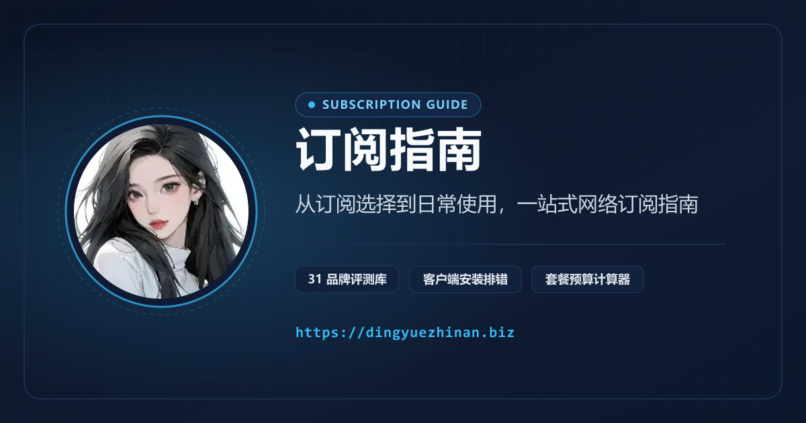

<div align="center">



# 订阅指南 · Subscription Guide

**从订阅选择到日常使用，一站式网络订阅指南**

[](https://astro.build/)
[](https://react.dev/)
[](https://tailwindcss.com/)
[](https://www.typescriptlang.org/)
[](https://pagefind.app/)
[-10B981?style=flat-square)](https://dingyuezhinan.biz/)

[在线域名 `dingyuezhinan.biz`](https://dingyuezhinan.biz/) · [编辑准则与数据状态](https://dingyuezhinan.biz/editorial-policy/) · [全站 QA 报告](./reports/build-report.md)

</div>

---

## 项目定位与核心能力

**订阅指南（Subscription Guide）** 是一个基于 **Astro Static** 构建的简体中文网络订阅知识库、机场评测数据库、第三方代理客户端指南与商业决策平台，专注解决用户在订阅前、选购中与日常排障时的完整链路问题。

- **结构化品牌与套餐数据库**：收录 **31 家**去重机场品牌与 **214 档**结构化套餐记录，真实保留多源口径冲突（`conflicting`）、历史档案（`historical`）与待核实字段（`unverified`），不作人工猜词填充。
- **单域名三大内容体系 + 10 大一级导航栏目**：全站共 **213 篇 Markdown** 内容，构建输出 **220 个静态 HTML 页面**（其中 **218 个**可索引着陆页纳入 `sitemap.xml` 与 Pagefind 中文全文索引，累计索引 **85,594 词**）。
- **实用决策交互工具（React Islands）**：
  - 套餐流量需求计算器（`/plans/traffic-calculator/`）
  - 订阅费用与单 GB 真实成本对比器（`/plans/cost-comparison/`）
  - 31 家品牌双边自由 PK 对比器（`/compare/`）
  - 全平台客户端兼容性查询（`/clients/`）
  - 品牌评测与优惠码页一键复制优惠码按钮（`CopyCouponButton`）
  - 新手订阅需求匹配器与多维品牌库筛选器（`/brands/`）
- **SEO / GEO 基础设施与质量门禁**：全站直出静态正文、JSON-LD 结构化数据（`Organization`、`WebSite`、`Article`、`CollectionPage`、`ItemList`、`SoftwareApplication`、`FAQPage`、`BreadcrumbList`），配套 6 项自动化验收脚本（内链断链、关键词互抢、推广链接隔离、中文文风与 Schema 校验）。

---

## 站内内容与路由矩阵

| 体系分类 | 覆盖路由 | 核心解决的问题 | 页面规模 |
|---|---|---|---|
| **教程知识体系** | `/guides/` · `/clients/` · `/troubleshooting/` · `/knowledge/` | 订阅链接用法、客户端安装校验、Mihomo / sing-box 配置、TUN / DNS、连接超时与故障排查 | 70+ 篇专业指南与客户端词条 |
| **评测决策体系** | `/reviews/` · `/brands/` · `/compare/` · `/network/` · `/ai-streaming/` · `/risks/` | 31 家品牌深度档案、实测/解锁矩阵、21 篇双边横向对比、IEPL/IPLC 线路与跑路避坑 | 31 家品牌评测 + 60+ 篇专题与横评 |
| **商业转化体系** | `/recommend/` · `/plans/` · `/deals/` · `/vpn/` | 新手/长期/多端榜单、月付/年付/不限时定价决策、全品牌优惠码与冲突核验汇总 | 榜单、套餐对比与优惠决策中枢 |

---

## 技术栈与项目结构

```text
dingyuezhinan.biz/
├── public/
│   ├── .htaccess                 # Apache HTTPS / 非 www 301 重定向、缓存与安全响应头
│   ├── robots.txt                # 爬虫抓取规则与 sitemap.xml 声明
│   ├── og-default.png            # 1200×630 默认社交分享 OG 图
│   └── images/                   # WebP 缩略图、品牌图标与实测参考截图
├── reports/
│   ├── Preventive_SEO_Audit_Report.md  # 预防性 SEO/GEO 审计与复测报告
│   ├── build-report.md           # 构建、Pagefind 与 QA 实测验收表
│   └── content-coverage.md       # 213 篇内容覆盖分布与待办统计
├── scripts/
│   ├── audit-internal-links.mjs  # 全站 HTML 内链零断链扫描
│   ├── check-affiliate-links.mjs # Markdown 推广外链隔离检查
│   ├── check-brand-data.mjs      # 31 品牌与 214 套餐资产一致性校验
│   ├── check-prose.mjs           # 自然中文行文红线检查
│   ├── detect-cannibalization.mjs# 340 个关键词互抢（Cannibalization）审计
│   ├── generate-og-image.mjs     # Sharp 自动合成 1200×630 OG 分享图
│   ├── sync-sitemap.mjs          # 同步输出扁平化 dist/sitemap.xml
│   └── validate-schema.mjs       # JSON-LD 与 HTML SEO 标签校验
├── src/
│   ├── components/               # 品牌卡片、图表看板、React 决策工具、SEOHead、导航与页脚
│   ├── content/                  # articles / clients / compare / guides / pillars / reviews / subtopics 等
│   ├── data/                     # brands.json / plans.json / benchmarks.json / clients.json / keywords 等
│   ├── layouts/                  # BaseLayout / ArticleLayout / TopicLayout
│   ├── lib/                      # SEO Schema 构建器、内链与内容辅助函数
│   └── pages/                    # Astro 静态路由与 rss.xml / llms.txt 端点
├── .env.example                  # 搜索引擎站长验证码环境变量模板
├── astro.config.mjs              # Astro 静态构建与 Sitemap 集成配置
└── tailwind.config.mjs           # 简白编辑风与 Dark Observatory 主题色板
```

---

## 本地开发与构建命令

> 环境要求：Node.js 20+ 与 npm。

```bash
# 1. 安装依赖
npm install

# 2. 启动本地开发服务器
npm run dev

# 3. TypeScript 与 Astro 静态类型检查
npm run check

# 4. 生产构建（Astro Static + sync-sitemap + Pagefind 中文索引）
npm run build

# 5. 本地预览生产构建产物 (dist/)
npm run preview
```

### 自动化质量验收套件

```bash
# 运行完整 QA 检查（品牌资产、外链隔离、内链断链、关键词冲突、Schema、内容统计）
npm run qa:all

# 运行自然中文表达检查
node scripts/check-prose.mjs

# 重新生成默认 1200×630 OG 分享图
node scripts/generate-og-image.mjs
```

---

## 搜索引擎与上线部署配置

1. **站长验证码配置**：复制 `.env.example` 为 `.env`，填入实际验证码后重新执行 `npm run build` 即可将验证 Meta 静态注入 `<head>`（未填写时不输出空标签）：
   - `PUBLIC_GOOGLE_SITE_VERIFICATION`（Google Search Console）
   - `PUBLIC_BING_SITE_VERIFICATION`（Bing Webmaster Tools）
   - `PUBLIC_SHENMA_SITE_VERIFICATION`（神马站长平台）
   - `PUBLIC_BAIDU_SITE_VERIFICATION`（百度搜索资源平台）
2. **静态主机部署**：将 `npm run build` 生成的 `dist/` 目录上传至支持 `mod_rewrite`、`mod_headers`、`mod_setenvif` 与 `mod_expires` 的 Apache 虚拟主机或静态托管环境。
3. **Sitemap 提交入口**：上线后向各站长平台提交 `https://dingyuezhinan.biz/sitemap.xml`。

---

## 编辑准则与合规边界

- **商业链接严格隔离**：全站所有推广入口统一维护于 `src/data/affiliate-links.ts` 并包裹 `rel="nofollow sponsored noopener"`；商业展示顺序与评测结果及数据状态独立分离。
- **五级数据状态透明标注**：全站以 `measured`（有截图证据）、`vendor`（品牌方宣称）、`historical`（历史档案）、`unverified`（尚待核实）与 `conflicting`（多源口径冲突）明确标示资料边界。
- **合法合规使用提示**：站内整理的客户端安装、协议参数及跨境网络资料仅面向技术学习、科研检索与公开产品决策参考，使用者须遵守所在地法律法规及对应平台服务条款。
